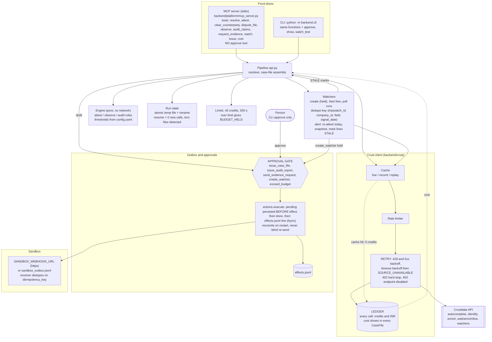

# AsOf architecture

Modules: `backend/engine/` (pure rules), `backend/pipeline/` (resolve, case files, CLI wiring), `backend/platform/` (MCP server, outbox, run state, watchers), `backend/crust/` (Crustdata client).

## Where the three controls sit
- **Retries:** inside the crust client (429 and 5xx wait and retry; timeouts back off, then the source is marked `SOURCE_UNAVAILABLE`; 402 stops the run). `backend/platform/util.py::with_retry` does the same for platform calls. Retries never touch the outbox: an irreversible action is not retried by the retry loop, it is reconciled by key.
- **Approvals:** one gate between a drafted item and the outbox. Approval transitions state once (a double click is a no-op). `execute_approved` refuses anything not approved. Only the CLI can approve.
- **Ledger:** at the bottom of the crust client, so every network call and every cache hit is recorded in credits and INR. The pipeline reads it to fill `CaseFile.cost`. In replay, spent is 0 and the recorded cost of the stored copies is shown separately.

## Why these pieces
- The engine has no network, so a rule is testable with a fixture and cannot spend credits.
- The outbox writes intent before effect, so a kill leaves a pending record to reconcile rather than a lost or doubled send.
- Known window: a kill after the send function returns but before the effects line is appended can repeat the send on restart. The webhook receiver must dedupe on `idempotency_key`.
