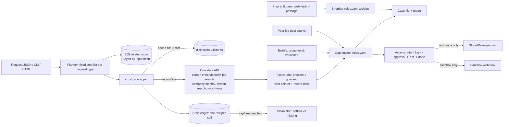

# Benefits Desk: build plan (Phase 1)

Branch `benefits-desk`, folder `BenefitsDesk/`. Written 22 Nov 2026, 16:00 IST. Code freeze is 18:00 (Builder Handbook, "The schedule").
Sources: `docs/builder-handbook.txt` (final source of truth), `ideas/RULES.md`, `ideas/18-benefits-desk.md` and its five Round 1 reviews, `ideas/_council/round2-brief-and-data-check.md`, `AsOf/` (engine to reuse), and docs.crustdata.com (read 22 Nov 2026).

## 0. Where repo rules override the brief

| Brief says | Repo rule that wins | What I do |
|---|---|---|
| Live data used freely in development (§7, §11) | RULES §3: no live calls by default; each data check needs team OK, stays ≤ 10 credits, runs in `MODE=record`, and its fixtures are committed | Live calls go in approved batches of ≤ 10 credits, recorded to `BenefitsDesk/fixtures/`. Default mode is replay. |
| "Kickoff kit" input/output formats | No kickoff kit exists in the repo; the team notes it was never seen (README "Open risks", round2 brief) | Use the Handbook's test-case shape ("What a test case looks like"): a request in a customer's words, plus the right result with its source. |
| `/web/search/live`, `/web/enrich/live` paths; prices from §7 | docs.crustdata.com pricing (read today): web fetch is `/web/enrich/live` at 1/page; person identify 1/match; job search 0.03/result, count-only (`limit: 0`) is free | Use the docs prices. AsOf's client calls `/web/fetch`, so web fetch goes through my wrapper with the docs path. |
| §1 "Four parts" in full, plus a 6-screen polished frontend | Handbook: code freeze 18:00; ~100 build minutes remain after go-ahead | Build in tiers (§4). The frontend becomes one generated HTML report unless Tier A finishes early. |
| Reuse AsOf's engine | AsOf `CLAUDE.md`: "Personal data: none"; its client hard-disables `person_search` / `person_enrich`; "Do not change other ideas' files" (brief §14) | Import AsOf's `CrustClient` read-only and call person endpoints through its generic `request()` from my own wrapper. No edit to any file under `AsOf/`. |

## 1. Stack and folder layout

The stack matches AsOf, so the team, the council scripts and the judges see one toolchain: Python 3.12, `uv`, `pytest`, `httpx`, `pyyaml`, `python-dotenv`. SQLite (stdlib) holds the step store, intent log and ledger.

```
BenefitsDesk/
  PLAN.md  README.md  pyproject.toml  .env.example
  config.yaml          # limits, output fields, mode, as-of dates   (requirement-change drill)
  rules.yaml           # ALL business rules: gaps, package, ranking, phrases, group minimum  (live-fix drill)
  bd/
    cli.py             # headless entry: bd run <request.json> [--chaos] ; bd approve ; bd status ; bd forget
    api.py             # tiny HTTP API (stdlib http.server) + server-sent events for the UI   [Tier B]
    store.py           # SQLite: steps (input-hash keyed), intents, ledger, facts, beliefs (versioned)
    crust.py           # wrapper over AsOf CrustClient: cache + record/replay, writes ledger rows, docs prices
    pointers.py        # resolve (record_id, field_path | char range) -> value; else CANNOT_VERIFY
    persona.py         # five questions + checked facts from person record -> fact file
    peers.py           # job-post benefit counts (count-only aggregations, sample passages)
    beliefs.py         # workplace-group beliefs, valid_from/valid_to versions, group-size suppression
    gaps.py            # rules.yaml -> gaps (pure function)
    insurers.py        # regulator figures with quoted passage + date            [Tier B]
    alarm.py           # job change by crustdata_company_id compare; watch-run path  [watch Tier B]
    actions.py         # intent log, approval, prefill / conversion request / test-mode purchase
    report.py          # case file JSON + Markdown/HTML report, fields from config
  fixtures/            # recorded Crustdata responses (personal data redacted)
  requests/            # the three Open-track test requests + hard cases
  tests/               # unit, cases, chaos (20 kills), requirement-change and live-fix drills
```

## 2. Components and data flow (becomes the architecture diagram)



Retries: exponential backoff with jitter on timeout/429 (AsOf client does 1-2-4 s and honours `x-ratelimit-reset`); a step fails after the limit and the run reports it as missing. Actions are never retried without the intent check.

## 3. Input and output formats

**Input** (`requests/*.json`), the Handbook test-case shape:
```json
{"id": "T1", "type": "employee_review | employer_package | peer_benchmark | job_change_check",
 "said": "I just moved jobs, is my health cover still on?",
 "persona": {"profile_url": "...", "consent": true,
             "answers": {"age_band": "25-34", "dependants": 1, "city": "Jaipur",
                         "cover_held": ["employer_group_health"], "monthly_budget_inr": 800}},
 "as_of": "2026-11-22", "since": "2026-09-01"}
```
The request type is chosen by a field, not by a model, so the same case worded another way gets the same answer.

**Output:** a case file (JSON + Markdown/HTML). Each line has `statement`, `value`, `label` (told/checked/guessed/belief/rule), `source` (`record_id`, `field_path` or quoted passage, `record_date`, `retrieved_at`) or `cannot_verify` with `missing`. Then the gaps (rule id + facts used), the actions awaiting approval, and the cost (credits, ₹, calls, cache hits, seconds). **Which fields appear is listed in `config.yaml: output.fields`**, so a new field is a config change.

## 4. Build order, tiers and checkpoints

Tier A must ship by 17:30; Tier B only if A is green; Tier C is cut unless there is time left.

| # | Step | Tier | Checkpoint (command that proves it) |
|---|---|---|---|
| 1 | Skeleton: config, rules, SQLite store, ledger, CLI, `--chaos` | A | `bd run requests/empty.json --chaos` killed, re-run resumes; ledger rows present |
| 2 | Crust wrapper (cache, record/replay, ledger) | A | `bd smoke`: logistics India posts since 1 Sep 2026, and with "health insurance": counts reproduced (target 3,362 / 113), 0 credits (count-only) |
| 3 | Persona sign-up + fact file | A | `bd run requests/T3_no_record.json`: every fact shows label, source field, date; no-record person gets told-only + a question |
| 4 | Peer comparison (phrase list from rules.yaml) | A | counts per phrase with filter JSON and as-of time; silent post = "not mentioned" |
| 6 | Gap engine | A | `tests/test_live_fix.py` edits one rule in a temp copy of rules.yaml and the result changes, no code edit |
| 8 | Actions with approval (prefill, conversion request, test-mode purchase) | A | `tests/test_chaos.py`: 20 kill/restart runs, approve twice, assert exactly one effect each |
| 9 | Cover-gap alarm, direct path | A | T1 job change detected by `crustdata_company_id`; same-company promotion → no alarm |
| 12 | Docs: README, mermaid diagram, test cases, cost per job | A | file review; numbers taken from the ledger |
| 5 | Workplace beliefs, versioned over two dates | B | beliefs for one company at D1 and D2, old version closed, small group suppressed |
| 7 | Insurer shortlist (regulator figures via web fetch) | B | each figure opens its quoted passage; missing → cannot verify |
| 9b | Watch path (pull runs, save last run id) | B | direct and watch path give the same result on a recorded run |
| 10 | Employer package view | B | package per staff group, peer counts behind it |
| 11 | Frontend | C | Tier A/B ship one static HTML report per case file instead |

## 5. Edge cases (brief §9) and handling

| Case | Handling | Tier |
|---|---|---|
| Role change in same company | compare `crustdata_company_id` of default job before/after, never the `recently_changed_jobs` flag | A |
| Sister companies | different ids → two employers, plus a `confirm_with_person` flag | A |
| Several current jobs | `is_default: true` is the main job; none flagged → cannot verify, ask | A |
| First-of-month dates | ±1 month tolerance in every date comparison (`rules.yaml: date_tolerance_months`) | A |
| Old leavers | leaver only if end date at that employer is in the window | B |
| Record refreshed before window | cannot verify + refresh date | A |
| Two people one name | never pick; ask for the profile link (input requires a URL; name-only → refuse) | A |
| Two companies one name | cannot verify unless a domain or id breaks the tie | A |
| Duplicate sign-up | one persona; merge only on exact normalized profile URL | A |
| Person marked removed (`match_status: redacted`) | stop; tell the person the record is unavailable | A |
| No public record | told-only facts, question to the person | A |
| Told vs checked conflict | show both, ask, no decision on that fact | A |
| Group below minimum | suppress belief, say so | B |
| Job post silent on benefits | "not mentioned", never "no cover" | A |
| Insurer figure missing/stale | cannot verify, or shown with its date | B |
| Empty search result | free; stored as evidence | A |
| Timeout / 429 | backoff + jitter; step failed after limit; reported missing | A |
| Budget/time hit mid-run | clean stop, settled vs missing | A |
| Kill during action | intent check on restart before any retry | A |
| Double approve | one action (idempotency key) | A |
| Consent withdrawn | `bd forget <persona>` deletes facts, steps and cache rows for that person; prints a deletion receipt | A |
| Age band under 18 | stop | A |
| Personal data in logs | ledger and logs store hashed ids only; names never stored | A |

## 6. Test plan (brief §11)

- Unit: rules, date tolerance, label rules (guessed never drives advice; never age/health/family), group-size suppression, pointer resolution.
- Open-track cases in `requests/` with expected answers in `tests/cases.json`: **T1** opted-in persona with a new employer after 1 Sep 2026 (+ hard case: same-company promotion → no alarm); **T2** peer share of job posts mentioning cover since 1 Sep 2026; **T3** person with no public record → cannot verify + question. Also a duplicate sign-up and a lookalike company name.
- Live smoke test under a 2-credit cap (count-only job search is free).
- Kill test: 20 chaos runs, zero duplicate effects.
- Requirement-change drill: add an output field and lower the cost cap through `config.yaml` only.
- Live-fix drill: change one rule in `rules.yaml` and re-run in under five minutes.
- Measured cost and time of one full job, from the ledger, into the README.

## 7. Crustdata credits (docs prices, read 22 Nov 2026)

| Use | Calls | Credits |
|---|---|---|
| Smoke + peer counts (count-only job search) | ~12 | 0 |
| Sample job posts for quoted passages (limit 5) | ~4 | 0.6 |
| Person enrich, consenting personas | 2–3 | 2–3 |
| Company identify (persona employers + rivals, by domain) | ~5 | 1 |
| Beliefs: person search at one employer, limit 20 (+job history) | 2 | ~3 |
| Insurer pages via web fetch | ~4 | 4 |
| Watch create / `/test` / run reads | few | 0 (alerts 5 each: avoided) |
| **Development total** | | **≈ 11–12, cap 20**, in two approved batches of ≤ 10 |
| **One employee job** (enrich 1 + counts 0 + samples 0.15 + shared beliefs/insurers from cache) | | **≈ 1.2 credits ≈ ₹31**; cold run with beliefs ≈ 4.5 credits ≈ ₹117 (₹26/credit, RULES §2) |

## 8. RULES / Handbook checklist (ticked as each is proven)

- [x] Whole job: request in, case file + approval request out
- [x] Live data drives at least one decision (job-change alarm, peer counts)
- [x] Every fact: link to record + field/passage + record date; no model facts
- [x] Cannot verify names what is missing
- [x] Irreversible actions wait for a person; payments in test mode; sends go to sandbox only
- [x] Time and cost limit per run; ledger row per call (model calls too, if any)
- [x] Kill/restart: each action exactly once (20-run chaos test)
- [x] Output fields and limits are config; rules in one file
- [x] Three test cases + duplicate + lookalike + cannot verify, dated after 1 Sep 2026
- [x] One record per person/company under two names (exact-id merge only)
- [x] Only the personal data the job needs; consent; deletion on withdrawal
- [x] Never contacts real outside people
- [x] README (job, who pays, input, result, pass mark, data sources, broker-tool licence note), diagram, cost per job
- [x] Runs headless (CLI); frontend optional

### Status at build end (22 Nov 2026)
All items above are met and tested, with two exceptions, both stated in the README:
- Insurer regulator figures are CANNOT VERIFY: no IRDAI table URL was found.
- The watch path for the alarm is not built: the direct request is the path.
