# Benefits Desk

**An insurance desk for a company's own workforce, used by a licensed broker.** The employer side sees what similar employers promise and gets a cover package per staff group. Each opted-in employee learns what cover they hold, what is missing and what to do. When their records show a new employer, the desk states the date their old group cover ends and prepares the request to convert it. Nothing is bought or sent without the person's approval.

> This is a tool for a licensed insurance broker or agent. Comparing and advising on insurance for the public is regulated in India; the desk does not issue policies, set premiums or pay claims, and it never contacts anyone who has not opted in.

## The service
- **Who does this job today:** employee-benefits brokers and insurance advisers. **Who pays:** insurers, through the broker's commission on each policy placed (Builder Handbook, Insurance theme: "Brokers, through a commission on each policy they place"). The commission rate is not sourced here, so no rupee comparison is claimed.
- **Our price:** ₹150 per employee review and ₹1,500 per employer benchmark *(estimates, not sourced)*.
- **Measured cost per job** (from the ledger, ₹26.4 per credit; that rate is itself an estimate from RULES.md §2):

| Job | Credits | ₹ | Time (cold, record mode) |
|---|---|---|---|
| Employee review (person record 1.0 + job-post counts 0 + 2 quoted sample posts 0.06) | 1.06 | ≈ 28 | ≈ 6 s |
| Cover-gap alarm, direct request (person record) | 1.00 | ≈ 26 | < 2 s |
| Employer view with workplace beliefs (role counts 0, person-search counts + 2 × 10 leaver rows; measured across two runs) | 6.68 | ≈ 176 | ≈ 200 s (rate-limited) |
| Any repeat or resumed run | 0 | 0 | < 0.1 s |

Count-only job searches (`limit: 0`) cost nothing, which makes the employer benchmark almost free.

## What it does end to end (headless)
| Request | Finished result |
|---|---|
| `employee_review` | Fact file (Told / Checked / Guessed, each with its source field and date), cover gaps from `rules.yaml`, insurer shortlist on regulator figures, a pre-filled application **waiting for approval** |
| `job_change_check` | Cover-gap alarm: job-change date, old cover end date, conversion deadline, a conversion request **waiting for approval** |
| `peer_benchmark` | Count and share of peer job posts mentioning each cover phrase, with the filter JSON, the as-of time and quoted passages |
| `employer_package` | Package per staff group (drivers, warehouse, office) with the rule behind each item, peer counts by role, and versioned workplace beliefs |

Where it still needs a person: approving any send; answering the questions it raises (no public record, a told fact that conflicts with a checked one, which insurer when none can be ranked).

## How to run (fresh clone)
```bash
cd BenefitsDesk
uv sync
cp .env.example .env            # add CRUST_KEY only for record/live mode; replay needs no key
uv run python -m bd run requests/T2_peer_share.json          # replay: committed fixtures, 0 credits
uv run python -m bd run requests/T1_job_change.json
uv run python -m bd approve <key printed under Actions> --by person
uv run python -m bd sandbox &                                  # our own receiver; never a real insurer
uv run python -m bd act <run_id>                               # sends approved actions exactly once
uv run pytest -q                                               # 52 tests incl. the 20-trial kill test and a real server restart
# UI: cd web && npm install && npm run build && cd .. && uv run python -m bd serve
#   http://127.0.0.1:8787/          guided flow: sign in -> confirm card -> two questions -> bento dashboard
#   http://127.0.0.1:8787/console   operator console: run stream, ledger, kill and resume
```
Modes: `--mode replay` (default, `config.yaml`), `record` (calls Crustdata, caches every response), `live`. `--chaos` kills the process at random step boundaries.

## The guided flow (person-facing)
1. **Sign in.** A LinkedIn link (or name + company), a 4-digit PIN and a consent tick. Only profiles on `config.yaml consenting_personas` are ever looked up; any other link gets "this demo only works for people who have agreed" and **no call is made**. **This is demo sign-in, not identity proof**: anyone who knows an allowlisted link could create the account first. A production version would use *Sign in with LinkedIn* (OAuth). The PIN is stored as a salted PBKDF2 hash; 5 wrong PINs lock the account for 10 minutes; a wrong PIN and an unknown account get the same message. The session is an HttpOnly cookie, so a refresh keeps you signed in.
2. **Confirm card.** One person lookup pre-fills where you work, your job, when you started and your city as **Checked** facts with source pointers. If the record has education end years, an age band is estimated as *end year minus 22* and shown as **Guessed**, with the education field as its basis. You confirm or change each item; a confirmed or changed age becomes **Told**. The adults-only check runs on the **confirmed** age only, never on the estimate. No match, a removed (redacted) record, a name that matches more than one person, or no education dates: that item is asked as a plain question instead.
3. **Two questions:** who depends on you, and whether you have any insurance now (with "not sure"; "not sure" is never turned into a guess).
4. **Dashboard** (bento grid): 3D neighbourhood (group nodes only), profile with "checked on" dates, the **lookup trail** (You -> Your employer -> People like you -> Insurers -> Gaps: what was searched, source, records, credits, found / searched, cannot verify / skipped, live or replay with the recorded date, and the pointers behind each step; a step that made no call is never shown as found), insurers, gaps, next step (choose an insurer, approve, "sent once"), and the **diary**.
5. **Diary and date slider.** Built only from the versioned belief store (`persona_beliefs`, and group beliefs for your employer with at least the minimum group size); no new calls and no model-written text. The slider re-renders the profile and graph as believed on that date.
6. **Memory.** Everything above is kept in `state/desk.sqlite` (gitignored), keyed by a user id derived from the profile link. After a full server stop and start, link + PIN lands you on the same dashboard with **zero Crustdata calls** (tested). "Check for changes" re-runs the lookups; on the same day with unchanged inputs every step is reused from the step store at no cost, and any change becomes a diary entry. **Log out** ends the session; **Forget me** deletes every row about you, deletes the cached copy of your record, and unlinks your ledger rows (the cost stays, the link to you goes).
7. **Live / Replay switch** sets the mode for your next run: Live calls Crustdata (and records the response); Replay uses recorded responses and says so, with their date, in the trail.

**Insurers come from data, not a list.** A Crustdata company search finds Indian companies with a health-insurer legal name; `rules.yaml insurers` holds only selection rules (company type, a founding year and own web domain, no agent/branch/TPA names, one record per web domain), and up to 3 are enriched. On 22 Nov 2026 the search returned 13 records, and the rules kept 3 (Aditya Birla Health, Cigna TTK Health, Star Health and Allied); the other 10 were branch offices, agents, or records without a founding year or domain, each listed with its reason. Insurers are listed by name, never ranked by size; company facts (founded, staff-profile counts as two dated values side by side, head office) are labelled as company facts, not a measure of claim quality.

**Regulator figures, extracted from IRDAI's PDF.** `bd irdai-extract <pdf> --url <address>` reads the IRDAI Annual Report 2024-25 with `pypdf`, finds Statement 10 ("Incurred claims ratio of general and health insurers", page 374) and stores each standalone health insurer's row with the PDF address, page and the quoted row (`fixtures/irdai/statement10_health_icr.json`). A figure is attached only when the company name matches the regulator's row exactly (after normalising Co./Company, Ltd/Limited) and the number appears in the quoted row; otherwise it stays CANNOT VERIFY (for example Cigna TTK, which has no row under that name). The incurred claims ratio is claims incurred as a share of premium earned; **it is not a claim settlement ratio**, and the UI says so. The report has no insurer-wise complaints table, so complaints stay CANNOT VERIFY.

## How it's built

```mermaid
flowchart LR
  subgraph FRONT["Two front doors, one engine"]
    FILEREQ["Headless requests<br/>requests/*.json: employee_review, job_change_check,<br/>peer_benchmark, employer_package"]
    CONSOLE["Operator console @ /console<br/>run stream · ledger · kill & resume"]
    LOGIN["Guided sign-in @ /<br/>link/name+company + PIN + consent"]
  end
  FILEREQ --> CLI["CLI: bd run / approve / act / watch-*"]
  CONSOLE --> API["bd serve (stdlib HTTP)<br/>/api/run spawns `bd run` as its own process"]
  LOGIN -->|"HTTP + HttpOnly cookie"| API
  API --> ALLOW{"on config.yaml consenting_personas?"}
  ALLOW -->|"no: no call made"| NOPE["'this demo only works for people who agreed'"]
  ALLOW -->|"yes: PBKDF2 PIN check, 5 wrong = 10 min lock"| USERS[("users table: PIN hash · sessions · user_state")]
  USERS --> GREQ["request type=guided_review, user_id=uid"]
  CLI --> RUN["Run (pipeline.py) — one engine, every front door<br/>steps keyed by hash(run/scope, step, inputs)"]
  API --> RUN
  GREQ --> RUN
  RUN <--> SS[("SQLite step store<br/>scope=mine (per user+day+answers): your own steps<br/>scope=shared (per day): insurers/peer posts reused across every user")]

  RUN --> CL["Crustdata client (crust.py)<br/>mode: replay / record / live"]
  CL -->|"cache or fixture hit: 0 credits"| CA[("disk cache + committed fixtures/crust/*.json")]
  CL -->|"/person/enrich · /company/search · /company/enrich<br/>/job/search (count-only) · /person/search"| CD[("Crustdata API")]
  CL -->|"429 / 5xx / timeout"| RETRY["backoff with full jitter, up to max_retries"]
  CL -->|"would cross credit cap or time limit"| HELD["clean stop: held — settled facts kept, rest named as missing"]
  CL --> LED[("Cost ledger: one row per call, no personal data")]

  PDF[("IRDAI Annual Report PDF<br/>Statement 10, page 374")] -->|"bd irdai-extract (pypdf, offline, one-time)"| REGFIX[("fixtures/irdai/statement10_health_icr.json<br/>quoted row + page + URL, exact-name match only")]
  REGFIX --> INS["Insurers: Crustdata company facts<br/>+ regulator figures — never ranked"]

  RUN --> FACTS["Told / Checked / Guessed facts<br/>pointer = (record, field path); unresolved = CANNOT VERIFY"]
  RULES[["rules.yaml<br/>gaps · job change · package · insurer selection ·<br/>peer phrases · group minimum"]] --> ENG["Rules engine (pure, no model)"]
  FACTS --> ENG
  ENG --> INS
  ENG --> TRAIL["Lookup trail (guided dashboard)<br/>searched · source · records · credits · status · live/replay"]
  ENG --> BEL[("persona_beliefs + group beliefs<br/>versioned valid_from / valid_to")]
  BEL --> CASE["Case file / dashboard (report.py, guided.dashboard)<br/>diary + date slider read only this store, no new calls"]
  ENG --> CASE
  ENG --> INT["actions.py: intent log<br/>idempotency key = hash(action, persona/account id, payload)"]

  WATCH["watch.py: bd watch-create / -register / -pull<br/>same job_change rule fn + same action key<br/>as the direct request — one alarm, one action"] --> ENG
  CD -.->|"/watch/person/*/runs (polled; no public webhook URL yet, so create is refused)"| WATCH

  INT -->|"person approves: CLI / dashboard button<br/>a second click is a no-op"| APP{"approved"}
  APP -->|"execute(): status -> sending"| ASK{"restart found it still 'sending'?<br/>ask sandbox first: GET /inbox?key="}
  ASK -->|"found: mark done, never resend"| SB[("sandbox.py: our own receiver<br/>records every delivery — never a real insurer")]
  ASK -->|"not found / unreachable: hold, never send blind"| HELD
  APP -->|"POST /inbox, idempotency-key header"| SB
```

- **Two front doors, one engine.** The scripted headless requests (`requests/*.json`, used for the test-case table below), the operator console, and the guided dashboard all run through the same `Run` in `pipeline.py` — a `guided_review` request is just another request type next to `employee_review`/`job_change_check`/`peer_benchmark`/`employer_package`, sharing the same step store, Crustdata client, rules engine, intent log and sandbox.
- **Per-user vs. shared steps.** Guided-flow steps are scoped `mine` (your own employer/profile lookups, keyed by user + day + confirmed answers) or `shared` (insurers and peer job-post counts, keyed only by day) — so every signed-in user that day reuses the same insurer and peer-benchmark lookups at zero extra cost, which is also the 100x-volume answer.
- **Watch and direct request give one answer.** `bd watch-pull` reads finished Crustdata watch runs into the *same* `rules_engine.job_change` function and the *same* action idempotency key as a direct request, so whichever path fires first, the other is a no-op. `watch-create` is refused until `config.yaml watch.webhook_url` points at a public URL; the pull path needs no tunnel and is tested.
- **No language model in the core.** It is rules and lookups and gives the same answer every time, which is what the restart test needs, and it removes the main way a wrong fact gets in.
- **State:** `state/desk.sqlite` (runs, steps, intents, personas, facts, beliefs, events, users, sessions, user_state, persona_beliefs, persona_snapshots, watches, watch_cursor, ledger) and `state/sandbox.sqlite`, both gitignored and never committed. Stdlib HTTP server; React + Vite + Tailwind UI in `web/`.
- **Every rule** lives in [`rules.yaml`](rules.yaml); **every limit and output field** in [`config.yaml`](config.yaml).

## Sources and checks
| Data | Source | What is cited |
|---|---|---|
| Employer, title, job dates | Crustdata `/person/enrich` (stored copy) | field path, entry date, retrieved time. The record has no refresh date, so "no change since" is always CANNOT VERIFY |
| Peer job posts | Crustdata `/job/search` | filter JSON, `total_count`, retrieved time; sample passages by `content.description[a:b]` and the post URL |
| Workplace beliefs | Crustdata `/person/search` | filter JSON per belief, `total_count`, window dates; leavers confirmed per row at that employer |
| Insurers | Crustdata `/company/search` then `/company/enrich` | field path per fact (`basic_info.year_founded`, `headcount.timeseries[i].employee_count`, `locations.headquarters`) with the point date and retrieved time |
| Insurer claims figures | IRDAI Annual Report 2024-25 PDF, Statement 10, page 374 (extracted with pypdf) | PDF address, page, quoted row; CANNOT VERIFY without an exact row |
| Employer staff counts (diary, group level) | Crustdata `/company/enrich` | `headcount.timeseries` point dates |
| Your profile (guided flow) | Crustdata `/person/enrich` with education | field path per item; age estimate's basis `education.schools[i].end_year` |
| Age band, dependants, city, cover held, budget, insurer choice | the person | labelled **Told** |

**Approvals:** `submit_application` and `conversion_request` are irreversible, so they wait for `bd approve` (or the UI button). A double click is one action. Sends go only to our sandbox receiver.
**Ledger:** `uv run python -m bd ledger [run_id]`. Dev spend so far is in [`fixtures/DEV_LEDGER.md`](fixtures/DEV_LEDGER.md) (≈ 12 credits).

## Test cases (dated after 1 Sep 2026) and results
| Case | Correct answer | Result |
|---|---|---|
| **T1** opted-in persona, new employer after 1 Sep 2026 *(synthetic fixture: no consenting teammate has a job change)* | job change 2026-10-01 (Delhivery 5798 → TCI Express 5051), old cover ends 2026-09-01, conversion deadline 2026-10-01 already passed, conversion request awaiting approval | pass |
| **T1b** hard case: promotion in the same company | `same_company`: no alarm, no action | pass |
| **T2** share of logistics job posts in India since 1 Sep 2026 mentioning cover | 3,434 posts; health insurance 114 (3.3%), medical insurance 119, ESIC 17, mediclaim 3, accident cover 0; any phrase 246 (7.2%); filter + retrieved time | pass (live 22 Nov 2026) |
| **T3** person with no public record | CANNOT VERIFY employer facts, a question to the person, Told-only facts, 0 credits | pass (live) |
| **H1** duplicate sign-up (same profile, different URL form) | one persona (2 sign-ups), one action | pass |
| **H2** lookalike: name only, no profile link | refused: "a name alone can match several people; we never pick one" | pass |
| **H3** under 18 | stopped | pass |
| **E1** employer view, Delhivery · Gurugram | roles: drivers 16 posts (1 with cover), warehouse 39 (5), office 437 (29); joiners belief v1 20 (to 1 Oct), v2 9 (to 22 Nov) | pass (live) |

- **Kill test:** 20 trials under `--chaos` (kill probability 0.35 at every step boundary and inside the send), with approve clicked twice each time. Result: **82 kills, 20 deliveries, 0 duplicates.**
- **Requirement-change drill:** removing an output field and lowering the credit cap in `config.yaml` only (test).
- **Live-fix drill:** changing `R-GAP-6 budget_below` in `rules.yaml` changes the gaps, with no code change (test).

## Edge cases handled
Same-company role change (compares `crustdata_company_id`, not `recently_changed_jobs`) · several current jobs (`is_default`, else CANNOT VERIFY) · first-of-month dates (± 1 month) · leavers who left years ago (confirmed per row at that employer) · no refresh date (absence of change is CANNOT VERIFY) · name-only sign-up (refused) · duplicate sign-up (exact identifier only) · removed record (`match_status: redacted` → not processed) · no public record (ask; Told) · told vs checked conflict (show both, ask, no application) · group below the minimum (belief suppressed) · silent job post ("not mentioned") · missing insurer figure (CANNOT VERIFY, not ranked) · 429/timeout (backoff with jitter, then failed and not read as an answer; seen live) · cap/time reached (held before the call) · kill during a send (ask the sandbox before resending) · double approve · consent withdrawn (`bd forget`) · under 18 · personal data kept out of the ledger and logs.

## Approaches weighed
1. **A model that reads records and writes the advice:** fast to build, but it can state a fact that no record holds, and it can answer differently after a restart. Rejected for the core.
2. **Watches as the only trigger for the alarm:** watches fire at most hourly and a webhook can be missed across a kill. The **direct request** is the main path; the watch path pulls runs and shares the same rule function and action key.
3. **Rules plus pointers (chosen):** every outcome comes from a rule in one file, and every fact is a pointer that code resolves. Same answer every time, and a five-minute live fix is a YAML edit.

**What worked:**
- Count-only job search is free and exact.
- Step store and intent log survive kills.
- The 429 retry path was exercised by a real 429.

**What didn't:**
- Insurer regulator figures through Crustdata's web fetch: it does not read PDFs. Downloading IRDAI's PDF directly and extracting Statement 10 with pypdf worked (see above).
- `past.end_date` is not a filterable field, so leavers needed per-row checks.

**Hardest case:** a person whose record shows no change. Their record has no refresh date, so "nothing changed" cannot be verified. We say exactly that instead of "no alarm".

**Who it could get wrong:**
- Someone whose record is stale, so a real job change is missed. Guard: every "no change" says CANNOT VERIFY.
- A lookalike profile. Guard: a profile link is required, never a name.

## Not done (cut for time), and why not now
- **Live watch creation.** Crustdata needs a public notification URL and ours is local. `bd watch-create` refuses until `config.yaml watch.webhook_url` is set. The **pull path is built and tested**: `bd watch-pull <id>` reads finished runs after the last one processed, runs the same rule, prepares the same action key, and saves the run id. Direct and watch paths give the same alarm and one action (`tests/test_watch.py`).
- Insurer complaints figures: IRDAI's annual report has no insurer-wise complaints table. Claim settlement ratios are not in it either; only incurred claims ratios are.
- Real identity: the PIN sign-in is not identity proof; production needs Sign in with LinkedIn.
- Monthly leavers on the timeline.
- Sourced broker commission for the price.

**100 times the volume:**
- Count-only benchmarks are free and shared across employees.
- Person records cost 1 credit each and are cached.
- The rate limit (30/min) is the ceiling, so batches queue behind the throttle.

**A second client:** a separate state dir and `rules.yaml` per broker. The rules file *is* the broker's policy.
