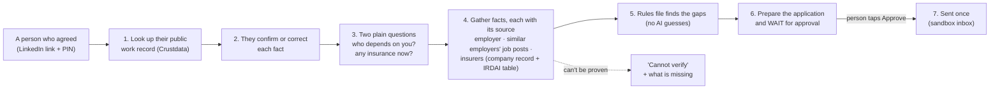

# Benefits Desk

**An insurance desk for a company's own workforce, used by a licensed broker.**
- **Each employee who opts in** learns what cover they hold, what is missing and what to do next. Every fact shows where it came from.
- **When a person's record shows a new employer,** the desk states the date their old group cover ends and prepares the request to convert it.
- **The employer side** sees what similar employers promise in job posts, and gets a cover package for each staff group.
- **Nothing is bought or sent** without the person's approval.

> **This is a tool for a licensed insurance broker or agent.** Comparing and advising on insurance for the public is regulated in India.
> - The desk does not issue policies, set premiums or pay claims.
> - It never contacts anyone who has not opted in.
> - "Sending" means our own sandbox inbox; nothing goes to a real insurer.

Built at ContextCon 05 (BITS Pilani, 22 Nov 2026), Open track. Nothing was written before 10:15 AM. Commits after the 18:00 code freeze start after `ecdc1a9`, which is the last commit before the freeze.

## How it works, in one picture

Every lookup is recorded with its cost. Every fact links to the record field it came from. A kill and restart at any point never sends anything twice.

## The service
- **The job:** advising employees on health, life and accident cover, finding gaps, and preparing applications. Also warning a person when changing jobs ends their group health cover.
- **Who does it today:** employee-benefits brokers and insurance advisers.
- **Who pays today:** insurers, through the broker's commission on each policy placed (Builder Handbook, Insurance theme: "Brokers, through a commission on each policy they place"). The commission rate is not sourced here, so no rupee comparison with today's cost is claimed.
- **Who would buy this:** a licensed broker serving an employer's workforce.
- **Our price:** ₹150 per employee review and ₹1,500 per employer benchmark *(estimates, not sourced)*.

## Input, finished result and pass mark
| Job | Input | Finished result | Pass mark |
|---|---|---|---|
| **Guided review** (person-facing UI) | Profile link + PIN + consent tick, a confirmation card, two tap answers | A dashboard with five parts: (1) the profile, each fact labelled Told, Checked or Guessed with its source and date; (2) the lookup trail; (3) insurers found from data; (4) gaps from `rules.yaml`; (5) a filled-in application waiting for approval. Plus a diary of how beliefs changed | Every fact resolves to a source field or "cannot verify". Nothing is sent before approval. One approval gives exactly one delivery. Returning after a restart makes zero calls |
| `employee_review` (CLI) | `requests/*.json`: profile link, five answers | Case file: fact file, cover gaps, insurers, application waiting for approval | Same as above |
| `job_change_check` (CLI) | Profile link | Cover-gap alarm: job-change date, old cover end date, conversion deadline, conversion request waiting for approval | New employer detected by `crustdata_company_id`; a promotion in the same company gives no alarm |
| `peer_benchmark` (CLI) | Since date | Count and share of logistics job posts in India that mention each cover phrase, with the filter JSON, as-of time and quoted passages | Counts reproduce exactly from the recorded responses |
| `employer_package` (CLI) | Employer company id + city | Package per staff group (drivers, warehouse, office staff) with the rule behind each item, peer counts by role, versioned workplace beliefs | Beliefs carry `valid_from`/`valid_to`; groups below the minimum size are suppressed |

**Where it still needs a person:**
- approving any send;
- confirming or correcting the looked-up facts;
- answering questions the record can't settle (no public record, "not sure", a told fact that conflicts with a checked one);
- choosing the insurer, since the desk never ranks insurers.

## How to run (fresh clone)
Needs Python 3.12 with `uv`, and Node 18+ for the UI.
```bash
cd BenefitsDesk
uv sync
cp .env.example .env            # CRUST_KEY is needed only for live/record mode; replay uses committed fixtures
uv run pytest -q                # 52 tests, incl. the 20-trial kill test and a real server restart

# Guided UI (person-facing) + operator console
cd web && npm install && npm run build && cd ..
uv run python -m bd serve       # http://127.0.0.1:8787/  guided flow; /console  run stream, ledger, kill, resume
                                # also starts the sandbox receiver on :8765

# Headless (CLI): every request runs without the UI
uv run python -m bd run requests/T2_peer_share.json            # replay, 0 credits
uv run python -m bd run requests/T1_job_change.json --chaos    # kills itself at random steps; re-run to resume
uv run python -m bd approve <key printed under Actions> --by person
uv run python -m bd act <run_id>                               # sends approved actions exactly once
uv run python -m bd ledger [run_id]                            # every call and what it cost
uv run python -m bd smoke                                      # live smoke test: job-post counts, 0 credits
uv run python -m bd irdai-extract <pdf> --url <address>        # re-extract IRDAI Statement 10 from the PDF
```
- **Modes:** `replay` (the default, from `config.yaml`) answers only from recorded responses. `record`/`live` call Crustdata and store each response. In the UI, the Live/Replay switch sets the mode for the person's next run.
- **Sign in:** only the two profiles in `config.yaml consenting_personas` can be looked up. Pick any 4-digit PIN on your first visit.

## The guided flow
1. **Sign in.**
   - **Form:** a LinkedIn link (or name + company), a 4-digit PIN, and a tick box: "This is my own profile and I agree to it being looked up."
   - **Allowlist:** only allowlisted profiles are ever looked up. Any other link gets "this demo only works for people who have agreed", and **no call is made**.
   - **PIN:** stored as a salted PBKDF2 hash. Five wrong PINs lock the account for 10 minutes. A wrong PIN and an unknown account get the same message.
   - **Session:** an HttpOnly cookie, so a page refresh keeps you signed in.
   - **This is demo sign-in, not identity proof:** anyone who knows an allowlisted link could create the account first. A production version would use *Sign in with LinkedIn*.
2. **Confirm card.**
   - **Pre-fill:** one person lookup fills in where you work, your job, your start date and your city as **Checked** facts, each with its field path.
   - **Age guess:** if the record has education end years, an age band is estimated as *end year minus 22* and shown as **Guessed**, with `education.schools[i].end_year` as its basis.
   - **Your check:** you mark each item Correct or Change it. A confirmed or changed age becomes **Told**.
   - **Adults only:** this check runs on the **confirmed** age only, never on the estimate.
   - **Fallback:** if there's no match, a removed (redacted) record, a name matching more than one person, or no education dates, that item becomes a plain question.
3. **Two questions:** who depends on you, and whether you have any insurance now. Both offer "not sure", which is never turned into a guess.
4. **Dashboard** (bento grid): a 3D neighbourhood of group nodes only, the profile with "checked on" dates, the lookup trail, insurers, gaps, the next step and the diary.
5. **Lookup trail:** You → Your employer → People like you → Insurers → Gaps. Each step shows:
   - what was searched and the data source;
   - records returned and credits spent;
   - status: *found*, *searched, cannot verify*, *skipped* or *computed*;
   - live or replay, with the recorded date for a replay;
   - the source pointers behind it.

   A step that made no call is never shown as found.
6. **Diary and date slider:**
   - **Source:** built only from the versioned belief store, with no new calls and no model-written text. That covers your own beliefs and group beliefs for your employer.
   - **Entries:** date, subject, new belief, previous belief, trigger, source, label, and whether a gap or the next step changed.
   - **Subjects:** only you, or groups at or above the minimum group size in `rules.yaml`. Never a named colleague. Unchanged values make no entry.
   - **Slider:** re-renders the profile and graph as believed on that date.
7. **Memory:**
   - **Storage:** everything is kept in `state/desk.sqlite`, which is gitignored and never committed, keyed by a user id derived from the profile link.
   - **Return after a restart:** after a full server stop and start, link + PIN lands you on the same dashboard with **zero Crustdata calls** (tested).
   - **Check for changes:** re-runs the lookups. On the same day with unchanged inputs, every step is reused from the step store at no cost.
   - **Log out:** ends the session.
   - **Forget me:** deletes every row about you and the cached copy of your record, and unlinks your ledger rows. The cost stays; the link to you goes.

## Insurers, from data
- **Search:** a Crustdata company search finds Indian companies with a health-insurer legal name.
- **Selection rules:** `rules.yaml insurers` holds only these, never names. A company is kept if:
  - its company type is a private or public company;
  - it has a founding year and its own web domain;
  - its name has no agent, branch or TPA wording.

  Only one record is kept per web domain, and up to 3 are enriched.
- **Result on 22 Nov 2026:** the search returned 13 records and the rules kept 3: Aditya Birla Health, Cigna TTK Health, and Star Health and Allied. The other 10 are listed with their reasons: branch offices, agents, or no founding year or domain. The recorded responses are in `fixtures/crust/`.
- **Coverage:** Niva Bupa and Care Health do not appear in this dataset under a legal-entity name, so they are not listed.
- **No ranking:** insurers are listed by name and never ranked.
- **Company facts are labelled as company facts, not a measure of claim quality.** They are: founded; staff-profile counts as two dated values side by side, never a growth figure; and head office.

**Regulator figures, from IRDAI's PDF.**
- **Extraction:** `bd irdai-extract` reads the IRDAI Annual Report 2024-25 with `pypdf`. It finds Statement 10, "Incurred claims ratio of general and health insurers", on page 374, and stores each standalone health insurer's row with the PDF address, page and quoted row in `fixtures/irdai/statement10_health_icr.json`. The figures are extracted by code; none were typed in by hand.
- **Matching:** a figure is attached only when the company name matches the regulator's row exactly (after normalising Co./Company and Ltd/Limited) and the number appears in the quoted row.
- **Results:** Star Health shows 70.30% for FY 2024-25 (66.47% for 2023-24); Aditya Birla Health shows 71.50% (68.31%).
- **Cigna TTK has no row under that name, so it stays "cannot verify".**
- **The incurred claims ratio is claims incurred as a share of premium earned. It is not a claim settlement ratio**, and the UI says so.
- **Complaints** stay "cannot verify": the report has no insurer-wise complaints table.

## How it's built

```mermaid
flowchart LR
  subgraph FRONT["Two front doors, one engine"]
    FILEREQ["Headless requests<br/>requests/*.json: employee_review, job_change_check,<br/>peer_benchmark, employer_package"]
    CONSOLE["Operator console @ /console<br/>run stream · ledger · kill & resume"]
    LOGIN["Guided sign-in @ /<br/>link/name+company + PIN + consent"]
  end
  FILEREQ --> CLI["CLI: bd run / approve / act / watch-*"]
  CONSOLE --> API["bd serve (stdlib HTTP)<br/>/api/run spawns `bd run` as its own process"]
  LOGIN -->|"HTTP + HttpOnly cookie"| API
  API --> ALLOW{"on config.yaml consenting_personas?"}
  ALLOW -->|"no: no call made"| NOPE["'this demo only works for people who agreed'"]
  ALLOW -->|"yes: PBKDF2 PIN check, 5 wrong = 10 min lock"| USERS[("users table: PIN hash · sessions · user_state")]
  USERS --> GREQ["request type=guided_review, user_id=uid"]
  CLI --> RUN["Run (pipeline.py) — one engine, every front door<br/>steps keyed by hash(run/scope, step, inputs)"]
  API --> RUN
  GREQ --> RUN
  RUN <--> SS[("SQLite step store<br/>scope=mine (per user+day+answers): your own steps<br/>scope=shared (per day): insurers/peer posts reused across every user")]

  RUN --> CL["Crustdata client (crust.py)<br/>mode: replay / record / live"]
  CL -->|"cache or fixture hit: 0 credits"| CA[("disk cache + committed fixtures/crust/*.json")]
  CL -->|"/person/enrich · /company/search · /company/enrich<br/>/job/search (count-only) · /person/search"| CD[("Crustdata API")]
  CL -->|"429 / 5xx / timeout"| RETRY["backoff with full jitter, up to max_retries"]
  CL -->|"would cross credit cap or time limit"| HELD["clean stop: held — settled facts kept, rest named as missing"]
  CL --> LED[("Cost ledger: one row per call, no personal data")]

  PDF[("IRDAI Annual Report PDF<br/>Statement 10, page 374")] -->|"bd irdai-extract (pypdf, offline, one-time)"| REGFIX[("fixtures/irdai/statement10_health_icr.json<br/>quoted row + page + URL, exact-name match only")]
  REGFIX --> INS["Insurers: Crustdata company facts<br/>+ regulator figures — never ranked"]

  RUN --> FACTS["Told / Checked / Guessed facts<br/>pointer = (record, field path); unresolved = CANNOT VERIFY"]
  RULES[["rules.yaml<br/>gaps · job change · package · insurer selection ·<br/>peer phrases · group minimum"]] --> ENG["Rules engine (pure, no model)"]
  FACTS --> ENG
  ENG --> INS
  ENG --> TRAIL["Lookup trail (guided dashboard)<br/>searched · source · records · credits · status · live/replay"]
  ENG --> BEL[("persona_beliefs + group beliefs<br/>versioned valid_from / valid_to")]
  BEL --> CASE["Case file / dashboard (report.py, guided.dashboard)<br/>diary + date slider read only this store, no new calls"]
  ENG --> CASE
  ENG --> INT["actions.py: intent log<br/>idempotency key = hash(action, persona/account id, payload)"]

  WATCH["watch.py: bd watch-create / -register / -pull<br/>same job_change rule fn + same action key<br/>as the direct request — one alarm, one action"] --> ENG
  CD -.->|"/watch/person/*/runs (polled; no public webhook URL yet, so create is refused)"| WATCH

  INT -->|"person approves: CLI / dashboard button<br/>a second click is a no-op"| APP{"approved"}
  APP -->|"execute(): status -> sending"| ASK{"restart found it still 'sending'?<br/>ask sandbox first: GET /inbox?key="}
  ASK -->|"found: mark done, never resend"| SB[("sandbox.py: our own receiver<br/>records every delivery — never a real insurer")]
  ASK -->|"not found / unreachable: hold, never send blind"| HELD
  APP -->|"POST /inbox, idempotency-key header"| SB
```

- **Two front doors, one engine.** The scripted headless requests (`requests/*.json`, used for the test-case table below), the operator console, and the guided dashboard all run through the same `Run` in `pipeline.py` — a `guided_review` request is just another request type next to `employee_review`/`job_change_check`/`peer_benchmark`/`employer_package`, sharing the same step store, Crustdata client, rules engine, intent log and sandbox.
- **Per-user vs. shared steps.** Guided-flow steps are scoped `mine` (your own employer/profile lookups, keyed by user + day + confirmed answers) or `shared` (insurers and peer job-post counts, keyed only by day) — so every signed-in user that day reuses the same insurer and peer-benchmark lookups at zero extra cost, which is also the 100x-volume answer.
- **Watch and direct request give one answer.** `bd watch-pull` reads finished Crustdata watch runs into the *same* `rules_engine.job_change` function and the *same* action idempotency key as a direct request, so whichever path fires first, the other is a no-op. `watch-create` is refused until `config.yaml watch.webhook_url` points at a public URL; the pull path needs no tunnel and is tested.
- **Agents and models:** there is no language model at run time. The core is rules and lookups and gives the same answer every time, which is what the restart test needs, and it removes the main way a wrong fact gets in. Claude Code (Opus) wrote the code, with a subagent building the React UI.
- **Tools:**
  - Crustdata API (person enrich, company search and enrich, job search, person search), with watch pull code;
  - `pypdf` for the IRDAI PDF;
  - Python 3.12 stdlib HTTP server and SQLite;
  - React, Vite, Tailwind and `3d-force-graph` for the UI.
- **State:** `state/desk.sqlite` (runs, steps, intents, personas, facts, beliefs, events, users, sessions, user_state, persona_beliefs, persona_snapshots, watches, watch_cursor, ledger) and `state/sandbox.sqlite`. Both are gitignored. It runs on a laptop, with no cloud services.
- **Config, not code:** every business rule lives in [`rules.yaml`](rules.yaml). Every limit, output field, allowlist entry and mode lives in [`config.yaml`](config.yaml).

## Sources and checks
| Data | Source | What is cited |
|---|---|---|
| Your profile (employer, job, start, city) | Crustdata `/person/enrich` (stored copy) | Field path, entry date, retrieved time. The record has no refresh date, so "no change since" is always "cannot verify" |
| Age estimate (Guessed) | Crustdata `/person/enrich`, `education.schools[i].end_year` | The basis and the arithmetic, shown on the card |
| Your employer's staff counts (group) | Crustdata `/company/enrich` | `headcount.timeseries` point dates. These are profile-derived counts and are never turned into a growth rate |
| People like you (job posts) | Crustdata `/job/search` | Filter JSON, `total_count`, retrieved time; quoted passages by `content.description[a:b]` and the post URL |
| Insurers | Crustdata `/company/search` then `/company/enrich` | Field path per fact, with the point date and retrieved time |
| Insurer claims figures | IRDAI Annual Report 2024-25 PDF, Statement 10, page 374 | PDF address, page and quoted row; "cannot verify" without an exact row |
| Workplace beliefs (employer view) | Crustdata `/person/search` | Filter JSON per belief, `total_count`, window dates; leavers confirmed row by row at that employer |
| Dependants, insurance now, age, city (when asked), insurer choice | The person | Labelled **Told** |

- **Approvals:** `submit_application` and `conversion_request` are irreversible, so both wait for the person (UI Approve button or `bd approve`). A double click is one action. Sends go only to our sandbox receiver.
- **Retries:** exponential backoff with full jitter on timeouts, 429 and 5xx; a live 429 was hit and handled during the build. After the retry limit, the step is marked failed and never read as an answer.
- **Ledger:** one row per call, cache hits included at 0 credits. See it with `bd ledger`, or in the UI cost card and the console. All live calls made during the build are listed in [`fixtures/DEV_LEDGER.md`](fixtures/DEV_LEDGER.md): **≈ 30.3 credits (≈ ₹799)** in total.

## Cost and time per job
Prices are from docs.crustdata.com and this account's rate card (22 Nov 2026). Rupees use ₹26.4 per credit ($0.30 × ₹88, RULES.md §2), which is an *(estimate)*. The credit figures are from the ledger rows of the recorded calls.

| Job | Credits | ₹ |
|---|---|---|
| Guided review, new person: person record 1.0 + employer record 2.0 | 3.00 | ≈ 79 |
| Shared once per day across all people: insurer search 0.39 + 3 insurer records 6.0 + 2 quoted job posts 0.06 | 6.45 | ≈ 170 |
| Employee review (CLI): person record 1.0 + 2 quoted job posts 0.06; job-post counts are free | 1.06 | ≈ 28 |
| Cover-gap alarm (person record) | 1.00 | ≈ 26 |
| Employer view with workplace beliefs (measured across two runs) | 6.68 | ≈ 176 |
| Returning person, repeat or resumed run | 0 | 0 |

**Time:**
- A guided run replays in **0.04 s**, measured.
- The UI adds 1.2 s per step on purpose, so a kill can land mid-run.
- A cold live guided run is about 15 calls behind a 2.1 s throttle, roughly **35 s** *(estimate, not measured)*.
- The employer view took **≈ 200 s** live, measured, because of the rate limit.

## How we tested it
**52 automated tests** (`uv run pytest -q`):

| File | Tests | What they cover |
|---|---|---|
| `tests/test_rules.py` | 14 | Job-change rule, ±1-month date tolerance, labels, gaps, insurer ranking guard, group suppression, belief versions, live-fix drill |
| `tests/test_cases.py` | 12 | The Open-track cases end to end in replay, the requirement-change drill, cap hold, restart reuse |
| `tests/test_guided.py` | 21 | Intake, age estimate never used for the adults check, allowlist (no call), wrong PIN reveals nothing, lockout, restart memory with zero calls, Forget me removes every row, insurers from data and unranked, empty insurer search shows "cannot verify" in the trail, no hard-coded insurer names, trail honesty, diary subjects, slider history, IRDAI figures tied to quoted rows, one action key per account |
| `tests/test_http_restart.py` | 1 | A real server stop and start: cookie survives, same dashboard, zero Crustdata calls |
| `tests/test_watch.py` | 3 | The watch path and the direct path give the same alarm and one action |
| `tests/test_chaos.py` | 1 | **Kill test**: 20 trials with random kills at step boundaries and inside the send, approve clicked twice each time. **82 kills, 20 deliveries, 0 duplicates** |

**Also checked:**
- **Live smoke test** against Crustdata, bypassing the cache: 3,434 and 114 reproduced at 0 credits.
- **Browser runs:** full click-throughs in Chrome against the real backend:
  - sign in, confirm, questions and dashboard;
  - choose an insurer, approve, and see "Sent once";
  - the date slider;
  - log out, a wrong PIN, signing back in, a page refresh, Forget me.

## Test cases (dated after 1 Sep 2026) and results
| Case | Correct answer | Result |
|---|---|---|
| **T1**: opted-in persona, new employer after 1 Sep 2026 *(synthetic fixture: no consenting teammate has a job change)* | Job change 2026-10-01 (Delhivery 5798 → TCI Express 5051); old cover ends 2026-09-01; conversion deadline 2026-10-01 already passed; conversion request waiting for approval | pass |
| **T1b**, hard case: promotion in the same company | `same_company`: no alarm, no action | pass |
| **T2**: share of logistics job posts in India since 1 Sep 2026 mentioning cover | 3,434 posts. Health insurance 114 (3.3%), medical insurance 119, ESIC 17, mediclaim 3, accident cover 0. Any phrase: 246 (7.2%). Filter and retrieved time shown | pass (live, 22 Nov 2026) |
| **T3**: person with no public record | "Cannot verify" for employer facts, a question to the person, Told-only facts, 0 credits | pass (live) |
| **H1**: duplicate sign-up (same profile, different URL form) | One persona (2 sign-ups), one action | pass |
| **H2**: lookalike, name only, no profile link | Refused: "a name alone can match several people; we never pick one" | pass |
| **H3**: under 18 | Stopped | pass |
| **E1**: employer view, Delhivery · Gurugram | Roles: drivers 16 posts (1 with cover), warehouse 39 (5), office 437 (29). Joiners belief v1: 20 (to 1 Oct); v2: 9 (to 22 Nov) | pass (live) |
| **G1**: guided review, persona with no education dates | Age is asked, not guessed. Gaps R-GAP-2, R-GAP-3, R-GAP-4. Insurers: Aditya Birla 71.50%, Star Health 70.30%, Cigna TTK "cannot verify" | pass |
| **G2**: guided review, persona with an education end year of 2027 | Age guessed 18-24 (labelled Guessed, with its basis); city asked because none is on record | pass |
| **G3**: name + company that matches more than one person | No pick; all items asked as plain questions | pass |
| **G4**: link not on the allowlist | Refused; no call; no ledger row | pass |

**Drills:**
- **Requirement change:** removing an output field and lowering the credit cap through `config.yaml` only (tested).
- **Live fix:** changing `R-GAP-6 budget_below` in `rules.yaml` changes the gaps, with no code change (tested).

## Personal data and consent
- **Who can be looked up:** only the two team-member profiles that the project owner listed in `config.yaml` as having agreed. The name + company route is used only when it matches an allowlist entry, and the single match must be that same record.
- **What is fetched:** only what the job needs: work entries, city and education years. Names, headlines and photos are never stored in the case file or the ledger.
- **Committed fixtures are redacted:**
  - the two personas keep job entries, city and education years only;
  - people who did not opt in (workplace-belief rows) keep only company ids, dates and seniority.
- **Group level only:** beliefs and the diary are about groups at or above the minimum group size, never a named colleague.
- **Forget me** deletes every stored row about the person and the cached record.

## Edge cases handled
- **Job changes and dates:**
  - same-company role change: compares `crustdata_company_id`, not `recently_changed_jobs`;
  - several current jobs: uses `is_default`, else "cannot verify";
  - first-of-month dates: ± 1 month tolerance;
  - leavers who left years ago: confirmed row by row at that employer;
  - no refresh date on the record: absence of change is "cannot verify".
- **Identity and sign-up:**
  - name only: refused, or a single verified match only;
  - duplicate sign-up: merged on the exact identifier only;
  - removed (`redacted`) record: not processed;
  - no public record: ask, and label the answer Told;
  - told vs checked conflict: show both, ask, prepare no application;
  - under 18, by the confirmed age only.
- **Data gaps:**
  - group below the minimum: belief suppressed;
  - job post silent on benefits: counted as "not mentioned", never as "no cover";
  - insurer figure without an exact regulator row: "cannot verify";
  - empty search: "searched, cannot verify" in the trail.
- **Failures and limits:**
  - 429, timeout or 5xx: retry with backoff, then mark failed;
  - cap or time limit reached: held before the call;
  - kill during a send: ask the sandbox before resending;
  - double approve: one action.
- **Sign-in and privacy:**
  - wrong PIN and lockout;
  - link not allowlisted: no call;
  - consent withdrawn: Forget me;
  - personal data kept out of the ledger and logs.

## Approaches weighed
1. **A model that reads records and writes the advice.** Fast to build, but it can state a fact no record holds, and it can answer differently after a restart. Rejected for the core.
2. **Watches as the only trigger for the alarm.** Watches fire at most hourly, and a webhook can be missed across a kill. The direct request is the main path; the watch path pulls runs and shares the same rule function and action key.
3. **A fixed insurer list.** Easy, but it isn't data. Replaced by company search plus selection rules plus enrich.
4. **Rules plus pointers (chosen).** Every outcome comes from a rule in one file, and every fact is a pointer that code resolves. Same answer every time, and a five-minute live fix is a YAML edit.

**What worked:**
- Count-only job search is free and exact.
- The step store and intent log survive kills.
- The 429 retry path was exercised by a real 429.
- IRDAI's PDF table extracts cleanly with `pypdf`.
- Exact-name matching kept the wrong insurer from getting a figure.

**What didn't:**
- **Crustdata's web fetch can't read PDFs,** so the PDF is downloaded and parsed locally.
- **Web search** returned news pages, not regulator tables.
- **`past.end_date` isn't filterable,** so leavers needed row-by-row checks.
- **Many company records are branches or agents:** 10 of 13 insurer matches. Hence the selection rules.

**Hardest case:** a person whose record shows no change. The record has no refresh date, so "nothing changed" cannot be verified, and the desk says exactly that instead of "no alarm". A close second: after Forget me and a fresh sign-up, the same application produced the same action key and showed "Sent 2 times". The key now includes the account's creation time, and a test covers it.

**Who it could get wrong, and the guard:**
- **Someone whose record is stale,** so a real job change is missed. Guard: every "no change" says "cannot verify".
- **A lookalike profile.** Guard: profile link or a single verified match, never a name.
- **A person whose age guess is wrong.** Guard: the guess is only a pre-fill; the confirmed age decides.
- **An insurer judged by company size.** Guard: no ranking, and company facts are labelled as such.

## Not done yet, and why not now
- **Fresh data on "Check for changes" in Live mode.** The client uses a stored response first, so a re-check only fetches lookups never made before. The fix is a freshness rule (re-fetch after N hours). It's not done yet because it changes how much each re-check costs, and that needs a decision on who pays.
- **Live watch creation.** Crustdata needs a public notification URL and ours is local. `bd watch-create` refuses until `config.yaml watch.webhook_url` is set. The pull path is built and tested.
- **Real identity.** The PIN is not identity proof; production needs Sign in with LinkedIn, which needs app review.
- **Insurer complaints and claim settlement ratios.** Not in IRDAI's annual report insurer-wise. The next sources are the insurers' public disclosure forms.
- **More insurers.** Add search phrases, or match against IRDAI's own list of registered insurers.
- **Monthly leavers on the timeline.**
- **A sourced broker commission** for the price.

## The future of this service
- **The broker's desk becomes the default.** Once agents can do the whole job, every employee gets a standing benefits adviser, not a once-a-year form:
  - it watches for life events the person has agreed to share (new job, new dependant, a move);
  - it re-checks cover against the rules file and prepares the paperwork the day something changes.
- **The licensed broker's role shifts** from filling forms to setting the rules and approving the exceptions.
- **Regulator data becomes machine-readable,** so claim and complaint figures are quoted live instead of from an annual PDF.

## Scale
- **100 times the volume:**
  - insurer and job-post lookups are shared per day, so they don't grow with people;
  - each new person costs about 3 credits once, and returns cost nothing;
  - the 30-calls-per-minute rate limit is the ceiling, so first-time lookups queue behind the throttle.
- **A second client:** a separate state directory, `rules.yaml` and allowlist per broker. The rules file *is* the broker's policy.

## Repository map
| Path | What it is |
|---|---|
| `bd/` | Engine: client (`crust.py`), store, pipeline, rules engine, facts, peers, beliefs, insurers, IRDAI extractor, users and sign-in, guided run, actions and sandbox, watch, API, CLI |
| `rules.yaml` / `config.yaml` | All business rules / all limits, output fields, allowlist and modes |
| `requests/` | The test and demo requests |
| `fixtures/crust/`, `fixtures/irdai/` | Recorded responses (redacted) and the extracted IRDAI rows |
| `fixtures/DEV_LEDGER.md` | Every live call made while building |
| `tests/` | 52 tests |
| `web/` | Guided UI (`src/guided/`) and operator console (`/console`) |
| `PLAN.md` | The build plan and the RULES checklist |
