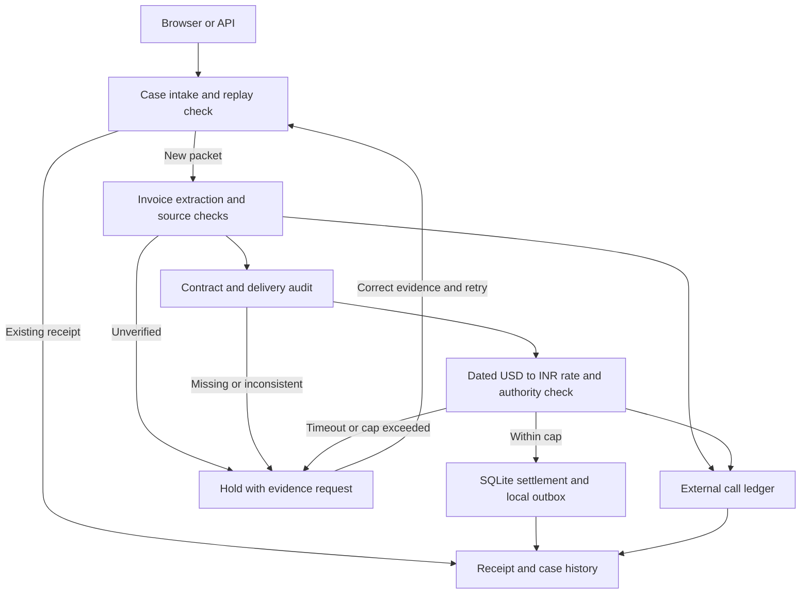

# FreightClose

A carrier billed $450 for keeping a truck waiting. The signed delivery record supports $150. FreightClose closes that discrepancy, posts the supported payable to a sandbox ledger and creates the carrier's short-pay notice.

## Why this job

- **Buyer.** A third-party logistics company pays a freight-audit team to reconcile carrier bills before accounts payable releases funds.
- **Demo.** One disputed line turns into a visible $300 deduction, an accounting entry and a notice that explains the arithmetic.
- **Scope.** One carrier, one purchase order and two charge types fit a solo build. A missing gate record gives the human reviewer a specific job.

**Track** — Buying and paying. **Client assumption** — an Indian 3PL audits a USD-denominated overseas carrier bill and measures its delegated spending authority in INR. The bundled carrier, contract and delivery records are fictional test fixtures.

## From invoice to receipt

| Input or decision | What FreightClose does | Evidence the operator can inspect |
|---|---|---|
| Carrier invoice text | Extract invoice ID, purchase order, line haul, detention and total in integer cents. Check the quoted lines. | Verbatim lines and the original invoice |
| Contract | Match the purchase order, reconcile the sum and cap line haul at the lower of billed and contracted amounts. | Invoice and purchase order references |
| Dwell time | Subtract free minutes, round down to completed hours, multiply by the contracted rate and cap at the billed detention. | Delivery record, contract and calculation |
| Local spending authority | Convert the approved USD amount into INR at a dated USD/INR reference rate. Hold the case if the conversion cannot be verified or the cap is exceeded. | Rate, reference date, source and cap |
| Close | Persist the supported payable and a short-pay or remittance notice in the local sandbox. A retry must never create a second payable for the same invoice. | Case history, action amounts and downloadable JSON receipt |
| Missing delivery evidence | Hold the bill with zero postings. The reviewer attaches verified minutes and a record reference. The service reruns its checks. | Original exception, supplied evidence and new decision |

The completed job ends at **audit and internal posting**. A deduction records a charge withheld before payment. Cash recovery, external remittance and delivery of notices to a carrier are outside this prototype.

## Run from the project directory

**Fastest rehearsal** — With Python 3.11+ installed, set the mode to mock (the default), run the command below from the project directory and open [the settlement desk](http://127.0.0.1:8000). This bundled HTTP adapter uses the same service code and plain HTML as FastAPI and needs no package installation.

```bash
python offline_server.py --port 8000
```

Add `--fresh` to start from an empty sandbox (it deletes only this mode's `*.sqlite3` file), which is what a recording needs. On macOS, double-click `start-freightclose.command` (or run `./start-freightclose.command --fresh`); on Windows, double-click `Start-FreightClose.cmd`. Both pick a free port and open the browser.

**FastAPI serving option** — On Windows PowerShell:

```powershell
py -3.11 -m venv .venv
.\.venv\Scripts\python -m pip install -r requirements.txt
Copy-Item .env.example .env
.\.venv\Scripts\python -m uvicorn app:app --port 8000
```

On macOS or Linux:

```bash
python3 -m venv .venv
source .venv/bin/activate
python -m pip install -r requirements.txt
cp .env.example .env
python -m uvicorn app:app --port 8000
```

Open [the settlement desk](http://127.0.0.1:8000). Select **Detention overcharge** and click **Audit and settle**. For the tests run `python -m unittest discover -v` with the same environment's Python.

**Rehearsal** — Set `FREIGHT_MODE=mock` in `.env`. The invoice parser and the 85.00 INR/USD fixture run locally with no model key.

**Live** — Set `FREIGHT_MODE=live` and `OPENAI_API_KEY` in `.env`, then restart the server. OpenAI extracts invoice fields and Frankfurter provides the dated rate used in the spending decision. Live mode needs working network access to both services. The OpenAI call sends the supplied invoice text to the provider. Use approved event data.

**Live rate, no model key** — Keep `FREIGHT_MODE=mock` and set `FREIGHT_FX=live`. The fixture reader parses the invoice and the authority check uses the real dated ECB rate from Frankfurter (94.96 INR/USD on 16 October 2026, so the sample payable is ₹242,148). Only the date range and currency pair leave the machine. The header and every receipt name both sources, for example `Fixture invoice reader · Live ECB rate`.

## Architecture



The model interprets invoice language. Python owns contract arithmetic and authority checks, so each figure can be recalculated from the receipt. The call ledger records external work separately from freight charges.

### Code map

| File | Responsibility |
|---|---|
| `app.py` / `offline_server.py` | FastAPI adapter and dependency-free HTTP adapter |
| `service.py` | Workflow, run budget, duplicate protection, SQLite transaction, case version history |
| `intake.py` / `samples.py` | Invoice evidence extraction and reproducible source fixtures |
| `engine.py` / `fx.py` | Freight contract arithmetic and dated INR authorization |
| `index.html` | Shipment intake, line-item audit, INR authority meter, receipts, source inspection and exception handling |
| `test_service.py` | Regression checks for supported charges, line items and hold paths |
| `test_posting.py` | Posting, replay, retry, notice, adapter and sandbox-reset checks |

## What counts as a pass

| Test | Expected result |
|---|---|
| $2,400 line haul plus $450 detention, 120 minutes recorded, first 60 free, $150 per completed hour | One $2,550 sandbox payable and one $300 short-pay notice if the INR cap permits it |
| Same bill submitted again | Prior settlement remains the sole payable. The response carries `replayed: true` and the desk shows "Duplicate blocked" |
| Original evidence-less packet resubmitted after a reviewer resolved it | The resolved receipt comes back as a replay, not a 409 |
| Detention claimed, delivery record missing | Review, with an explanation and no postings |
| Reviewer supplies 120 verified minutes and a gate-log reference | Re-audit settles the supported amount if the other checks pass |
| Sum mismatch, PO mismatch, unsupported evidence or unavailable live rate | No settlement |
| Rate-converted payable exceeds the INR authority cap | Review, with the amount and authority decision available for inspection |

## Data and limits

The model and live rate are the only external services. Frankfurter supplies a reference exchange rate for the authority check. Contract terms, delivered dwell time and the authority limit come from the input packet. Their authenticity depends on the caller. The review form captures a reference and the verified value. It does not authenticate a signature, read an attached gate-log image or independently validate delivery. The demo assumes USD, one PO, whole completed detention hours and exactly two positive-or-zero charge types. Taxes, partial loads, currencies beyond this pair and negotiated dispute outcomes need separate policies.

The competition requires real-world data in a decision, exact source references and an organizer-provided client format. Use live mode and the kickoff records for screening. This package uses its own packet schema because the kickoff kit was unavailable. The FX check supplies a live dependency even when Crustdata is unused. The offline run is a rehearsal. A real payment integration would require the event's test-mode provider plus human approval before the payment instruction. The local sandbox cannot demonstrate bank reconciliation.

## 150-minute solo build and honest commit sequence

Use the organizer-provided repo. Commit each working slice when it actually runs and preserve the original timestamps.

| Minutes | Commit subject | Check before committing |
|---|---|---|
| 0–15 | `chore: scaffold freight audit service and dated sample packet` | Inputs and expected receipt agree |
| 15–40 | `feat: extract and verify carrier invoice fields` | Each amount maps to invoice text |
| 40–65 | `feat: price freight and hold unsupported detention` | $2,550 payable and missing-proof hold |
| 65–90 | `feat: enforce INR authority with dated FX evidence` | Test both approval and a source failure |
| 90–115 | `feat: persist settlement receipts and deduplicate postings` | Resubmit one invoice twice |
| 115–135 | `feat: add settlement desk and evidence review` | Correct the missing record from the browser |
| 135–150 | `test: verify hard cases and document the demo` | Run the suite and rehearse the two-minute walkthrough |

[Demo script and recording cues](DEMO.md)

### Build checks

The service tests submit four concurrent copies, interrupt the receipt write, retry after an FX outage, and hold extra charges or ambiguous totals. The live extractor accepts descriptive charge labels when the model cites the exact invoice line and its accounting category is verifiable. The fixture reader uses a fixed label vocabulary. The cap example below can be repeated from a fresh database during judging.

## Reproduce a changed policy

The sample packet uses 16 October 2026 and a ₹300,000 authority cap. In mock mode, $2,550 × 85.00 = ₹216,750. To prove the rate affects the decision on a **fresh database before settling the original sample**, type `200000` into **Spending authority cap (₹)** and click **Audit and settle**: the authority meter turns amber, the case holds and nothing posts. The API takes the cap in paise (20,000,000). Use the [FastAPI interactive docs](http://127.0.0.1:8000/docs) when running the FastAPI adapter, or the PowerShell below.

```powershell
$desk = 'http://127.0.0.1:8000'
$packet = Invoke-RestMethod "$desk/api/sample"
$packet.case_id = 'CAP-200K'
$packet.cap_paise = 20000000
$body = @{packet = $packet} | ConvertTo-Json -Depth 6
$result = Invoke-RestMethod "$desk/api/run" -Method Post -ContentType 'application/json' -Body $body
$result | Select-Object status, actions, fx
```

The same check from macOS or Linux:

```bash
curl -s http://127.0.0.1:8000/api/sample \
  | python3 -c "import sys,json;p=json.load(sys.stdin);p.update(case_id='CAP-200K',cap_paise=20000000);print(json.dumps({'packet':p}))" \
  | curl -s -X POST -H 'Content-Type: application/json' --data @- http://127.0.0.1:8000/api/run \
  | python3 -c "import sys,json;r=json.load(sys.stdin);print(r['status'],r['fx']['reason'])"
```

`GET /api/status` reports both source modes and how many cases and payables the sandbox holds.

A fresh instance uses a local SQLite file per mode. Set `FREIGHT_DB` to a new file path for a clean rehearsal. Each downloadable receipt includes prior attempts, elapsed time, call estimates and the packet behind the decision. The service records the estimate available for each call. An unavailable provider can leave its actual charge unknown. FX retrieval allows at most five seconds of network inactivity, and the posting gate checks a 25-second processing budget. An operator can retry a held case with `POST /api/cases/{id}/retry`. This single-operator localhost prototype trusts input records and uses a single invoice-ID namespace.

